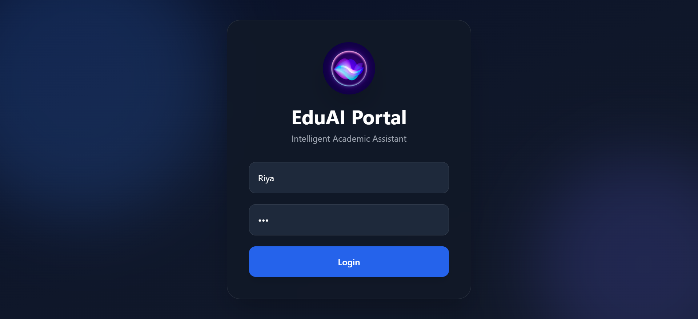
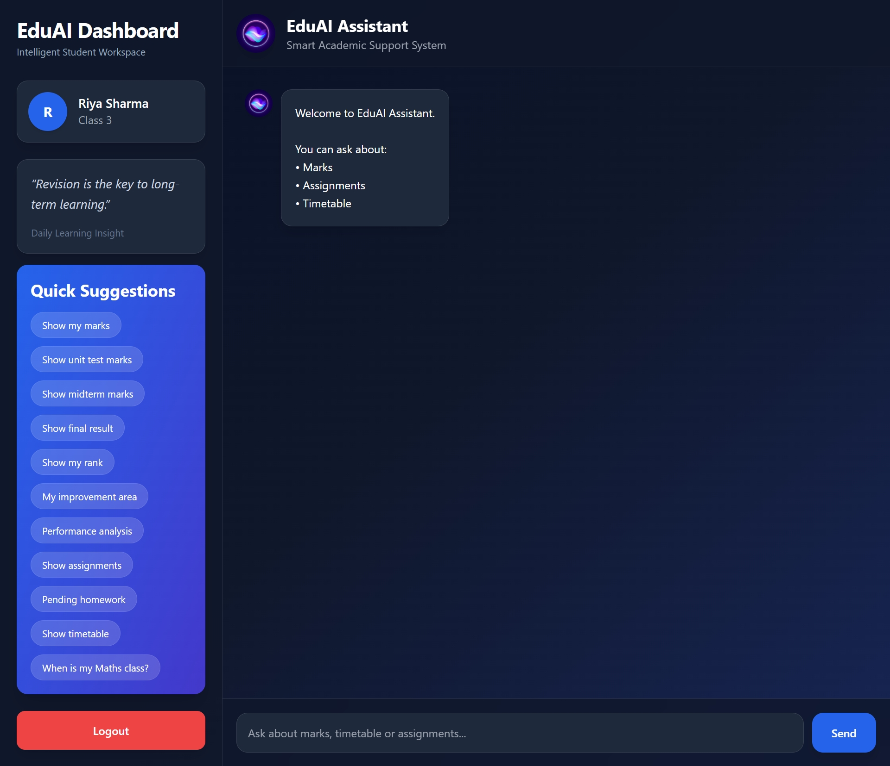
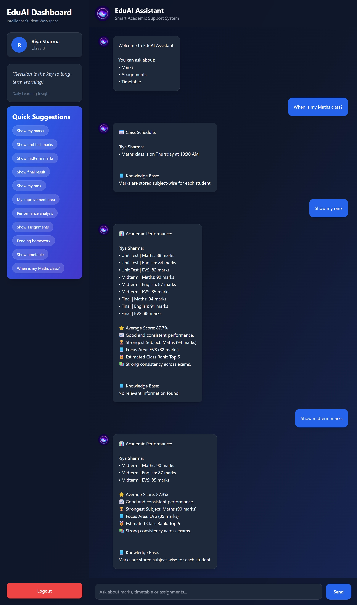
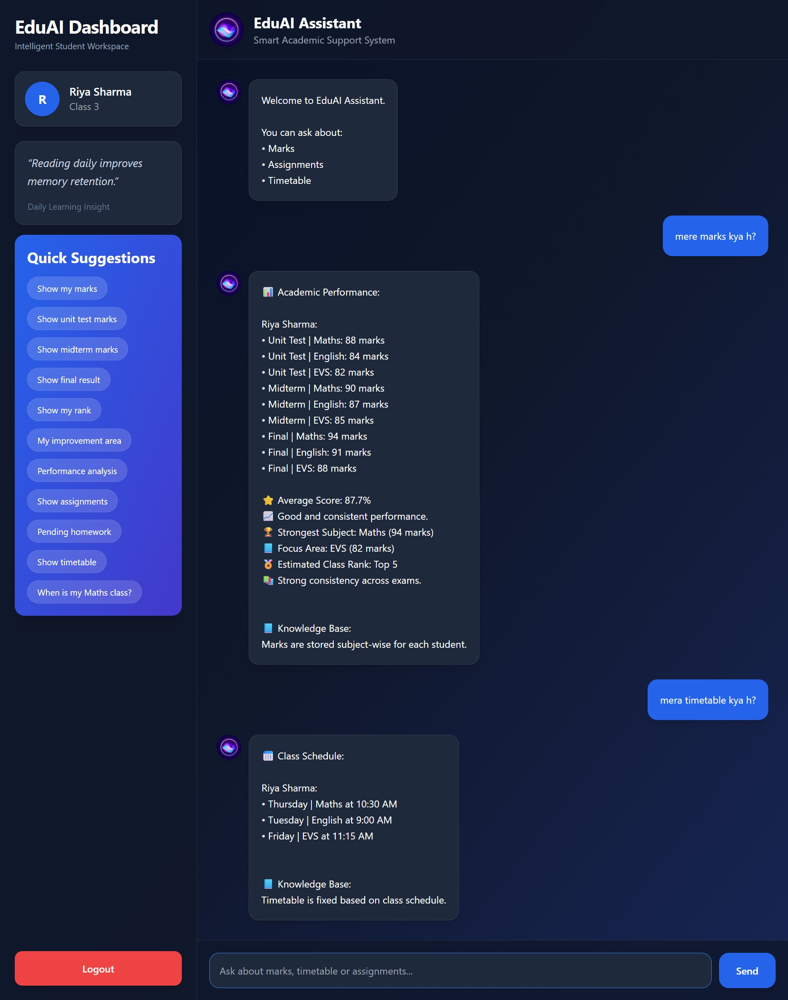

# EduAI — Multilingual School Chatbot with RAG

An AI-powered school chatbot that helps students and parents access academic information through natural-language questions. The project combines a modern React interface, a Python backend, SQL-based data retrieval, and Retrieval-Augmented Generation (RAG) for answering questions using relevant school information.

**Live Demo:** [EduAI School Chatbot](https://multilingual-school-chatbot-nl-sql.vercel.app/)

---

## Screenshots

### 1. Login Page



### 2. Chatbot Interface



### 3. English Conversation



### 4. Hindi Conversation



---

## Table of Contents

- [Overview](#overview)
- [Features](#features)
- [Live Demo](#live-demo)
- [Technology Stack](#technology-stack)
- [System Architecture](#system-architecture)
- [Project Structure](#project-structure)
- [How It Works](#how-it-works)
- [Local Installation](#local-installation)
- [Configuration](#configuration)
- [Deployment](#deployment)
- [Testing](#testing)
- [Security and Privacy](#security-and-privacy)
- [Limitations](#limitations)
- [Future Improvements](#future-improvements)
- [Author](#author)

---

## Overview

EduAI is a multilingual school chatbot designed to simplify access to academic information for students and parents.

Users can interact with the chatbot through a conversational interface instead of navigating multiple pages or searching through school documents manually.

The project explores how natural-language processing, structured database queries, and document retrieval can work together in an educational information system.

The application includes a dashboard-style interface with quick suggestions, a chat area, and academic performance summaries.

## Features

### 1. Conversational AI Interface

- Ask questions using natural language.
- View chatbot responses in a conversational layout.
- Use suggested questions to start common academic queries.
- Interact through a modern React-based interface.

### 2. Multilingual Queries

- Designed for English, Hindi, and Hinglish queries.
- Supports multilingual interaction according to the implemented query-processing logic.

### 3. SQL-Based Academic Information Retrieval

- Retrieve supported structured information from a school database.
- Handle academic queries using the application's database and retrieval logic.
- Access information such as marks, assignments, and timetables where supported by the configured data.

### 4. Retrieval-Augmented Generation (RAG)

- Retrieve relevant information from configured school documents.
- Use document retrieval as part of the question-answering workflow.
- Combine retrieved context with the application's response-generation logic.

### 5. EduAI Dashboard

- Dashboard-style chat interface.
- Quick suggestions for common school-related questions.
- Academic performance summaries where supported by the application.
- Student-oriented information display.

### 6. Student and Parent Workflows

- Provides student and parent account flows implemented by the application.
- Supports account-specific academic queries according to the backend's access-control logic.

### 7. React Frontend

- Built with React and Vite.
- Includes a chat interface, dashboard components, and user interaction elements.
- Deployed frontend available through Vercel.

> Feature availability and response accuracy depend on the current backend implementation, configured database, school documents, and account permissions.

---

## Live Demo

**Frontend:** [EduAI School Chatbot](https://multilingual-school-chatbot-nl-sql.vercel.app/)

The frontend is deployed on Vercel.

The backend must be running and correctly configured for database-backed and document-based chatbot requests to work.

- **Backend API:** Add the deployed backend URL once confirmed.
- **API Documentation:** Add the FastAPI `/docs` URL if available.

---

## Technology Stack

| Component | Technology |
|---|---|
| Frontend | React |
| Frontend tooling | Vite |
| Programming language | Python |
| Backend framework | FastAPI |
| Structured data retrieval | SQL |
| Database | SQLite or the database configured in the project |
| Document question answering | Retrieval-Augmented Generation (RAG) |
| Text embeddings | Sentence Transformers, if configured |
| Vector retrieval | FAISS, if configured |
| Numerical processing | NumPy |
| Machine learning utilities | scikit-learn |
| PDF processing | PyPDF |
| Version control | Git and GitHub |
| Frontend deployment | Vercel |

The exact runtime dependencies are defined in the project's dependency files.

---

## System Architecture

```text
                  Student / Parent
                         |
                         v
                  React + Vite UI
                         |
                         v
                   Backend REST API
                       FastAPI
                         |
               +---------+---------+
               |                   |
               v                   v
        Structured Query      Document Query
               |                   |
               v                   v
         SQL Database         RAG Retrieval
                                   |
                                   v
                            School Documents
               |                   |
               +---------+---------+
                         |
                         v
                  Retrieved Context
                         |
                         v
                   Chatbot Response
                         |
                         v
                   React Frontend
```

The frontend sends requests to the backend API. The backend processes supported queries using structured data retrieval, document retrieval, or other implemented application logic before returning a response.

## Project Structure

The project may contain the following files and directories. Keep this section aligned with the actual files in your repository.

```text
multilingual-school-chatbot-nl-sql-rag/
│
├── school-frontend/
│   ├── src/
│   │   ├── App.jsx
│   │   └── ...
│   ├── public/
│   ├── package.json
│   ├── package-lock.json
│   └── vite.config.js
│
├── screenshots/
│   ├── login.png
│   ├── interface.png
│   ├── english.png
│   └── hindi.png
│
├── school_docs_/
│   └── ... school reference documents
│
├── app.py
├── chatbot.py
├── database.py
├── frontend.py
├── rag.py
├── requirements.txt
├── README.md
└── .gitignore
```

Additional files, tests, assets, and configuration files may be present in the repository.

Do not commit local databases, private records, credentials, virtual environments, or generated files.

---

## How It Works

### Step 1: User Query

A student or parent enters a question through the chatbot interface.

Examples:

- Show my timetable.
- Show my assignments.
- What are my marks?
- Answer a question using the school documents.

### Step 2: Frontend Request

The React frontend sends the user's query to the configured backend API.

### Step 3: Query Processing

The backend processes the request according to the application's implemented logic.

Structured academic questions may use database retrieval, while document-related questions may use the RAG pipeline.

### Step 4: Information Retrieval

For structured queries, the application retrieves relevant records from the configured database.

For document-based queries, the RAG pipeline retrieves relevant text from supported school documents.

### Step 5: Response

The backend returns the response to the frontend, where it is displayed in the chat interface.

---

## Local Installation

### Prerequisites

Install the following software:

- Python 3.10 or a version compatible with the project's dependencies.
- Node.js and npm.
- Git.
- A code editor such as Visual Studio Code.

### 1. Clone the Repository

Replace the placeholders with your existing GitHub repository URL and folder name.

```bash
git clone <YOUR_EXISTING_GITHUB_REPOSITORY_URL>
cd <YOUR_REPOSITORY_FOLDER>
```

### 2. Set Up the Python Environment

From the project root, create a virtual environment.

**Windows PowerShell:**

```powershell
python -m venv venv
.\venv\Scripts\Activate.ps1
```

Install the Python dependencies:

```bash
pip install -r requirements.txt
```

If environment activation is restricted by PowerShell, use an appropriately configured terminal or invoke the virtual environment's Python executable directly.

### 3. Configure the Backend

Review the following files before starting the backend:

- `app.py`
- `database.py`
- `chatbot.py`
- `rag.py`
- `requirements.txt`

Confirm the FastAPI application entry point, database location, document paths, and any required environment variables.

**Important:** Inspect the database initialization code before running it. If initialization drops or recreates tables, it may erase existing local data.

Use synthetic demonstration records when testing the public version.

### 4. Start the FastAPI Backend

If `app.py` defines the FastAPI application object as `app`, run:

```bash
uvicorn app:app --reload
```

If the application object or module is named differently, adjust the command to match the code.

The local backend commonly runs at:

`http://127.0.0.1:8000`

If enabled, interactive API documentation is commonly available at:

`http://127.0.0.1:8000/docs`

### 5. Install Frontend Dependencies

Open a second terminal and navigate to the frontend directory:

```powershell
cd school-frontend
npm install
```

### 6. Configure the API URL

The frontend must point to the backend that serves its API requests.

If the frontend supports Vite environment variables, create a local `.env` file inside `school-frontend` with:

```text
VITE_API_URL=http://127.0.0.1:8000
```

This variable works only if the frontend code reads `import.meta.env.VITE_API_URL`. If the existing code uses another variable name or a hardcoded URL, configure it accordingly.

Do not commit `.env` files containing private configuration or credentials.

### 7. Run the React Frontend

From the `school-frontend` directory, run:

```bash
npm run dev
```

Open the local URL printed in the terminal. Vite commonly uses:

`http://localhost:5173`

Keep the backend running in a separate terminal.

---

## Configuration

Before running or deploying the application, verify the following:

- Backend API URL.
- Database connection and initialization settings.
- Location of school reference documents.
- Any model or embedding configuration used by the RAG pipeline.
- CORS settings for the frontend origin.
- Required environment variables.

Use the variable names expected by the actual application code. Never publish API keys, passwords, access tokens, or confidential configuration files.

---

## Deployment

### Frontend Deployment on Vercel

The current frontend is available at:

[EduAI School Chatbot](https://multilingual-school-chatbot-nl-sql.vercel.app/)

For a React/Vite deployment:

1. Import the GitHub repository into Vercel.
2. Set the root directory to `school-frontend` if it contains the frontend's `package.json`.
3. Use `npm run build` as the build command.
4. Use `dist` as the output directory.
5. Configure the production backend API URL using the environment variable expected by the frontend.
6. Ensure the backend allows requests from the deployed frontend origin.
7. Redeploy after changing environment variables.

### Backend Deployment

The FastAPI backend requires a separate deployment if it is not hosted by the same service.

The backend deployment must provide:

- A working API endpoint.
- Compatible Python dependencies.
- Correct database configuration.
- Access to required school documents.
- Suitable CORS configuration.
- Sufficient resources for the configured embedding model and retrieval pipeline.

A successful frontend deployment alone does not establish that the backend or database is available.

---

## Testing

Before publishing an update, verify the following manually and with automated tests where available.

- [ ] Frontend loads without errors.
- [ ] Login and logout behave as expected.
- [ ] Chat requests reach the configured backend.
- [ ] Timetable questions return relevant information.
- [ ] Assignment and homework queries work.
- [ ] Marks and academic summaries match the configured data.
- [ ] Supported Hindi and Hinglish questions are tested.
- [ ] Document-based questions retrieve relevant content.
- [ ] Student and parent access rules are enforced by the backend.
- [ ] The production frontend build succeeds.
- [ ] No private records or credentials are exposed.

---

## Security and Privacy

This project is intended for educational and demonstration purposes unless separately reviewed and hardened for production.

Before making the repository public:

- Use synthetic student and parent records.
- Exclude private databases and confidential school documents.
- Never commit API keys, access tokens, passwords, or private environment files.
- Review screenshots for personal or sensitive information.
- Verify that authorization is enforced by backend endpoints.
- Review password storage and login validation.
- Avoid using real student information in an unsecured public demonstration.
- Check the licensing and publication permissions of included reference documents.

Frontend restrictions alone do not protect backend data. Authentication, authorization, and data access must be verified in the backend implementation.

---

## Limitations

- Answers depend on the quality and coverage of the configured database and documents.
- Questions outside the implemented retrieval logic may not be answered reliably.
- Multilingual performance depends on the actual query-processing implementation.
- Scalability and production performance have not been established.
- Model initialization and document indexing may increase backend startup time and memory requirements.
- The availability of database-backed functionality depends on the backend deployment and database persistence.

---

## Future Improvements

Potential improvements include:

- Stronger authentication and authorization.
- More automated backend and frontend tests.
- Improved document citations with source filenames and page numbers.
- Better handling of ambiguous and multi-part questions.
- Evaluation of retrieval quality using a documented test dataset.
- Improved error handling and API monitoring.
- Deployment health checks and performance testing.

---

## Author

**Diya**

B.Tech in Computer Science and Engineering

Interests: Artificial Intelligence, Machine Learning, Generative AI, RAG Systems, and AI Application Development.

- **GitHub:** [DiyaMaheshwari2004](https://github.com/DiyaMaheshwari2004)

---
